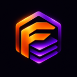

  

<h1 align="center">FerraStack</h1>

  Open-source developer tools for Android. 
  Rust where it counts, Kotlin where it's native.

---

| Project | What it is | Stack |
|---|---|---|
| [**Ferrux**](https://github.com/FerraStack/ferrux) | A terminal and Linux environment for Android, a modern alternative to Termux | Rust core · Kotlin shell |
| [**Ferride**](https://github.com/FerraStack/ferride) | A code editor built for phones, with syntax highlighting, LSP and a Ferrux-powered terminal | Rust core · Jetpack Compose |
| [**Lomio**](https://github.com/FerraStack/lomio) | A private chat app for running LLMs on your phone, fully offline | Jetpack Compose · llama.cpp |

All projects are licensed under **Apache-2.0**. They're in early development; contributions and issues are welcome.
